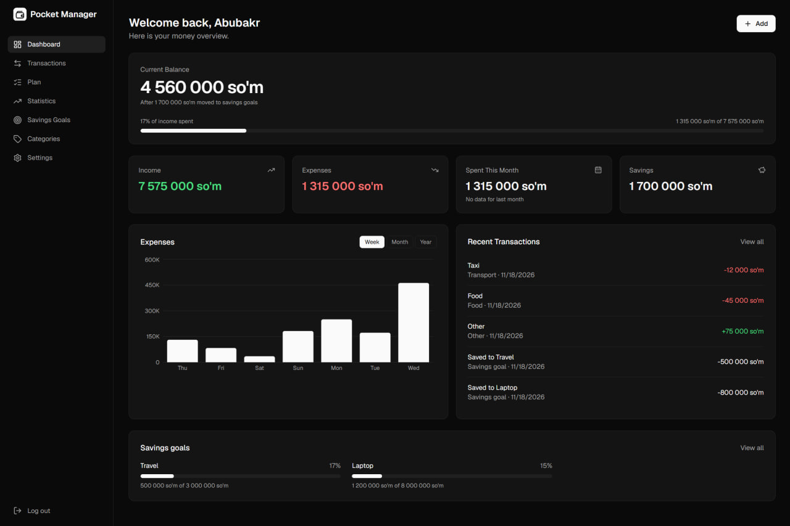
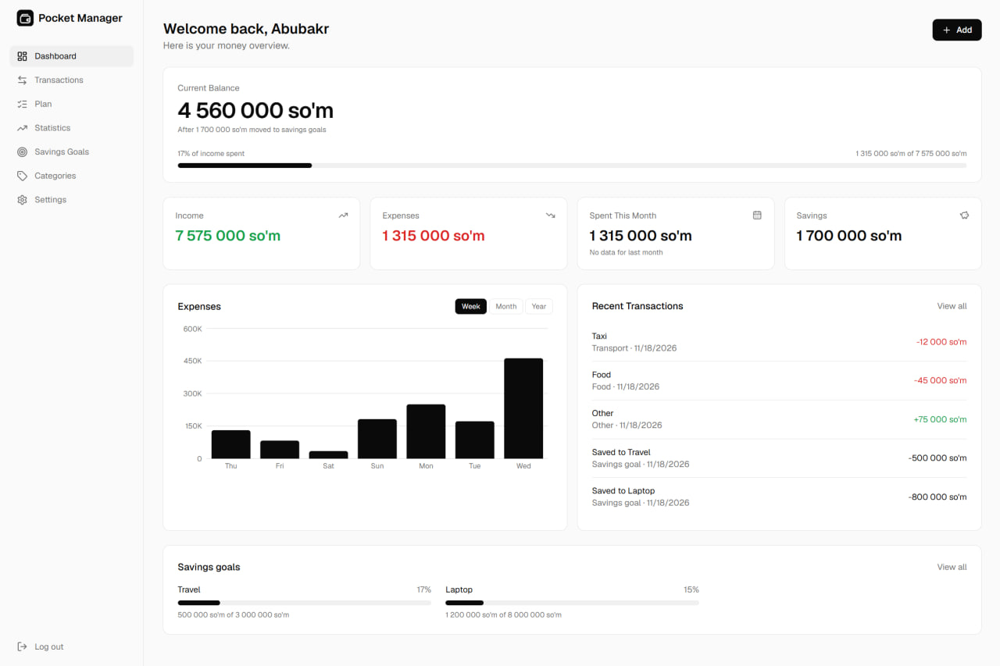
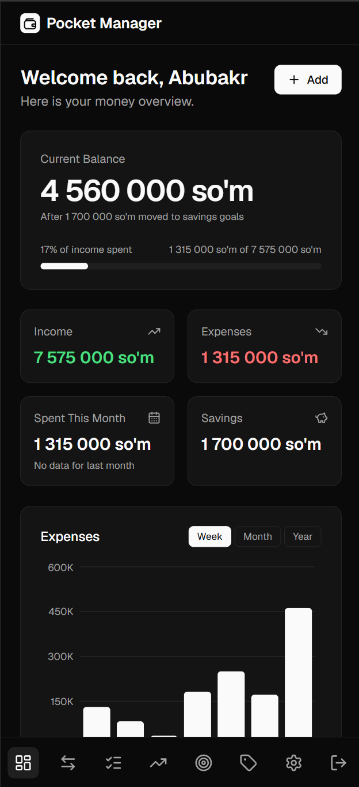
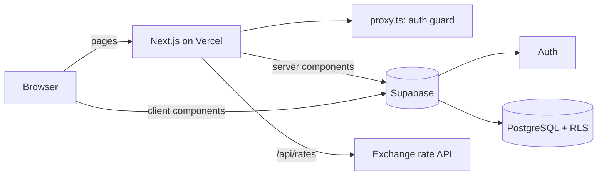
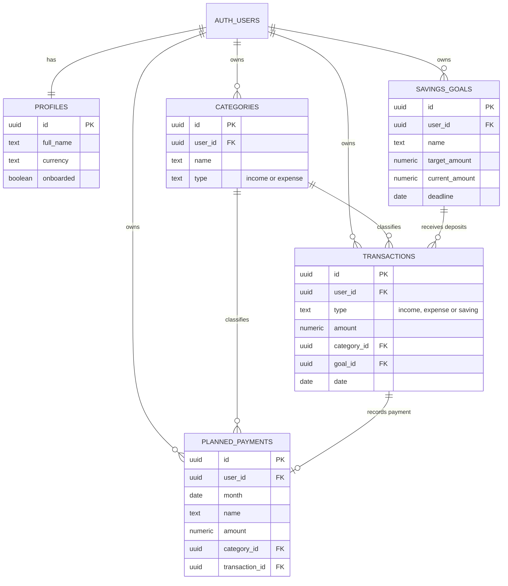
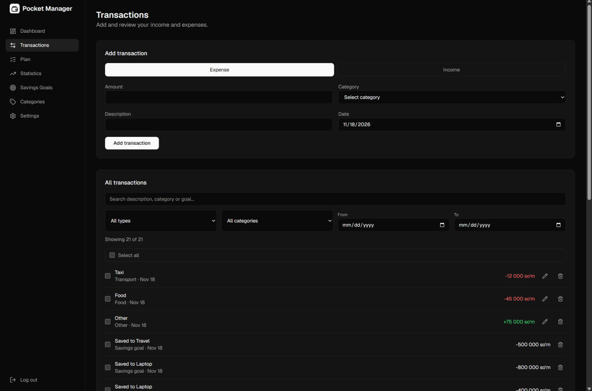
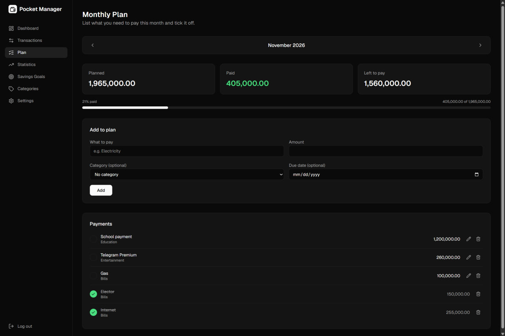
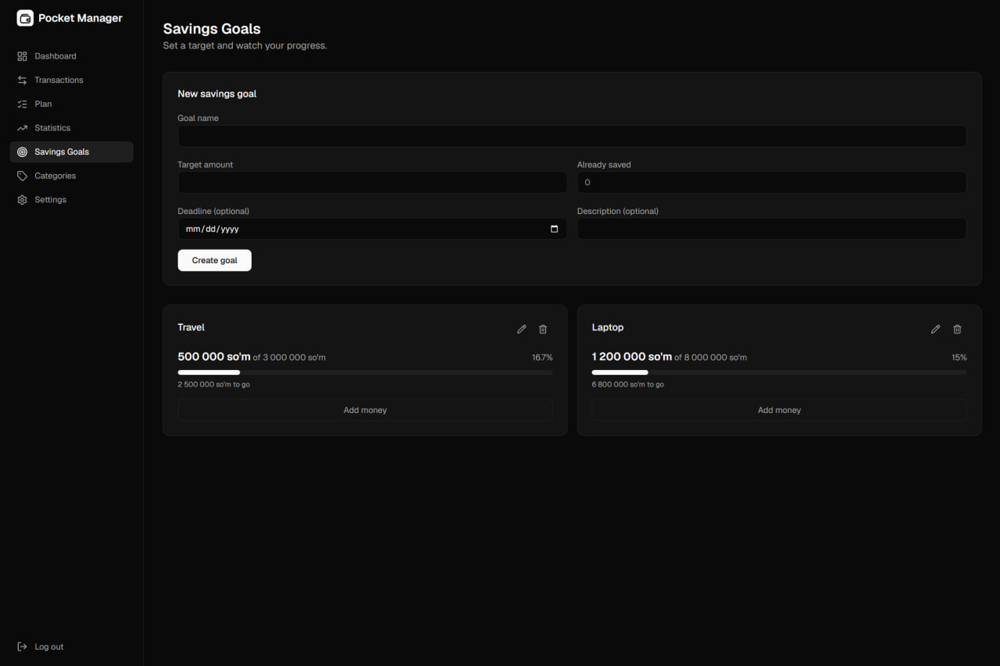
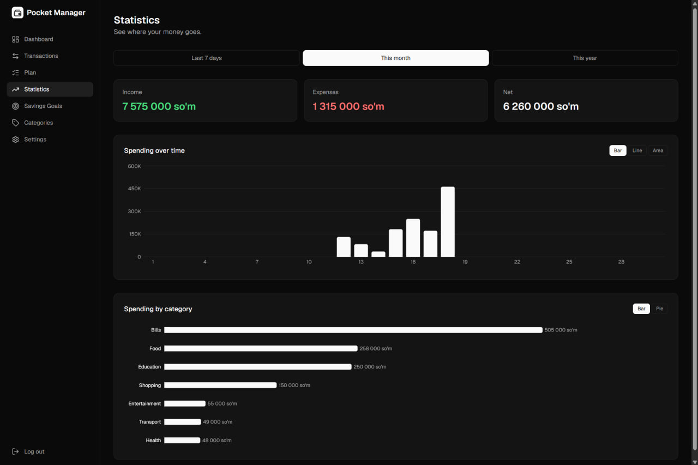
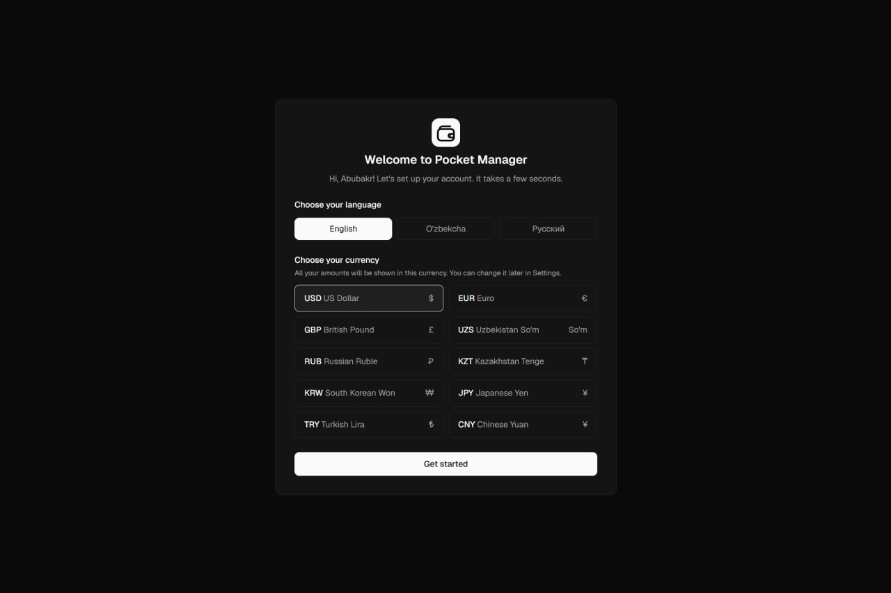

# Pocket Manager

**A personal finance manager for students.** Track income and expenses, plan your monthly payments and reach your savings goals, in your own language and currency.

**Live demo:** https://pocket-manager-five.vercel.app

> Sign up with any email to try it. Email confirmation is turned off for the demo.



| Light theme | Mobile |
|---|---|
|  |  |

## Why I built this

Students often receive money from several places (family allowance, a scholarship, part-time work) and it disappears without them knowing where it went. Most finance apps are made for adults, are only in English, assume dollars and hide the basics behind subscriptions.

I wanted something simple and free that works the way a student in Uzbekistan thinks: in **so'm**, in **Uzbek**, with a clear list of what must be paid this month.

### Problems it solves

- **"Where did my money go?"** Dashboard, category breakdown and spending trends answer this at a glance.
- **"What do I still have to pay this month?"** The monthly plan is a checklist. Ticking a payment records the expense automatically, so nothing is entered twice.
- **"Can I afford this?"** Savings goals with progress bars; money moved into a goal leaves the balance but is not counted as spending.
- **Language and currency barriers.** Full Uzbek, Russian and English interface, ten currencies including UZS, and conversion at the live exchange rate when you switch.

## Features

| Area | What you can do |
|---|---|
| **Accounts** | Register, log in and log out. Every page is protected; each person only ever sees their own data. |
| **Onboarding** | A welcome screen on first login to pick language and currency. |
| **Dashboard** | Balance, income, expenses, spending this month compared with the same days last month, recent transactions, goal progress, and a spending chart by week, month or year. |
| **Transactions** | Add, edit and delete. Search, filter by type, category and date range, and delete many at once. |
| **Categories** | Sensible defaults plus your own custom categories (rename and delete safely). |
| **Monthly plan** | List what you must pay each month, mark items paid (creates the expense automatically), see overdue items and copy last month's plan in one click. |
| **Savings goals** | Targets with deadlines and progress bars. Deposits are recorded as transactions and reduce the balance. |
| **Statistics** | Income, expenses and net for the last 7 days, this month or this year. Spending over time as bar, line or area chart; spending by category as bars or a pie. |
| **Currencies** | UZS, USD, EUR, GBP, RUB, KZT, KRW, JPY, TRY and CNY. Switching currency can convert all existing amounts at today's live rate, rounded to each currency's precision. |
| **Languages & themes** | English, Uzbek and Russian. Light, dark and system themes. |
| **Responsive** | Sidebar on desktop, bottom navigation on phones. |

## Tech stack

| Layer | Technology |
|---|---|
| Framework | Next.js (App Router), React, TypeScript |
| Styling | Tailwind CSS with CSS-variable theming |
| Database & auth | Supabase (PostgreSQL, Auth, Row Level Security) |
| Charts | Recharts |
| Hosting | Vercel (automatic deploys from GitHub) |
| Exchange rates | [Exchange Rate API](https://www.exchangerate-api.com) (open endpoint) |

## Architecture



Key design decisions:

- **Server components read, client components interact.** Pages load their data on the server; forms and charts run in the browser and talk to Supabase directly, protected by Row Level Security.
- **`proxy.ts` is the front door.** It checks the Supabase session on every request and redirects people who are not logged in.
- **The database is the security boundary.** Row Level Security policies, not application code, decide who can read or change a row. Only the public (publishable) key is used in the app.
- **Business rules live in the database where they must never break.** Constraints reject invalid data (negative amounts, wrong types). Triggers keep a savings goal's saved amount in sync with its deposits. Currency conversion is a single database function, so it either converts everything or nothing.
- **Money is stored as `numeric(12,2)`**, never floating point. The display currency is a profile setting.
- **Type-safe translations.** Interface text lives in three dictionaries; a missing key in any language is a compile error.
- **Theming with CSS variables**, so the whole interface (including charts) switches theme instantly.

## Database schema



The SQL for every table, policy, trigger and function is in [`supabase/`](supabase), numbered in the order it was applied.

## Security

- **Row Level Security on every table.** A user can only read and change their own rows.
- **No cross-account linking.** Policies also check that a referenced category, goal or transaction belongs to the same user, so one person cannot attach their data to someone else's.
- **Privileged database functions are locked down.** Trigger functions run with a fixed empty `search_path` and cannot be called from the client.
- **Only the publishable key reaches the browser.** No service-role key exists in the app, and `.env.local` is git-ignored.
- **Database constraints** reject invalid data even if the interface is bypassed.
- Data isolation was verified manually with a second account.

## Screenshots

| Transactions | Monthly plan |
|---|---|
|  |  |

| Savings goals | Statistics |
|---|---|
|  |  |



## Run it locally

You need Node.js 20+ and a free [Supabase](https://supabase.com) project.

```bash
git clone https://github.com/Abubakr-SAM/Pocket-Manager.git
cd Pocket-Manager
npm install
```

1. Create a Supabase project.
2. In the **SQL Editor**, run the files in [`supabase/`](supabase) in numeric order (`01` to `12`). Files `05` and `08` create and later remove an early experiment, which is harmless.
3. In **Authentication → Sign In / Providers → Email**, turn off *Confirm email* (for local testing).
4. Create `.env.local` in the project root:

```bash
NEXT_PUBLIC_SUPABASE_URL=your-project-url
NEXT_PUBLIC_SUPABASE_PUBLISHABLE_KEY=your-publishable-key
```

5. Start the app:

```bash
npm run dev
```

Open http://localhost:3000.

## Project structure

```text
app/
  (auth)/          login and register
  (dashboard)/     dashboard, transactions, plan, goals, statistics, categories, settings
  welcome/         first-login setup
  api/rates/       exchange-rate endpoint
components/        reusable UI (forms, lists, charts, dialogs)
lib/               formatting, currency, periods, i18n, Supabase clients
supabase/          database schema, policies, triggers and functions
proxy.ts           authentication guard
```

## What I learned

- Designing a multi-user database where security is enforced by the database itself (Row Level Security), including policies that validate relationships between rows.
- Keeping derived data consistent with database triggers, and making multi-table changes atomic with a single function.
- Handling money correctly: exact decimal storage, per-currency rounding and live exchange rates.
- Building a type-safe translation system and a theme system that also covers charts.
- Shipping a real product: production builds, environment variables and continuous deployment.

## Future improvements

- Export transactions to CSV and PDF
- Recurring transactions (subscriptions, rent)
- Per-transaction currencies with live conversion
- A monthly view on the dashboard
- Email confirmation with a custom SMTP provider
- Automated tests (unit and end-to-end)
- Spending insights, for example "you spent 18% more on Food than last month"

## Author

**Abubakr Sultonxo'jayev**: designed and built Pocket Manager as part of my university application portfolio.

[GitHub](https://github.com/Abubakr-SAM)
